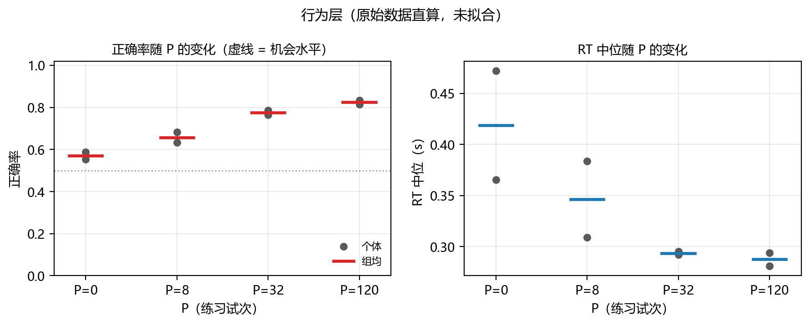
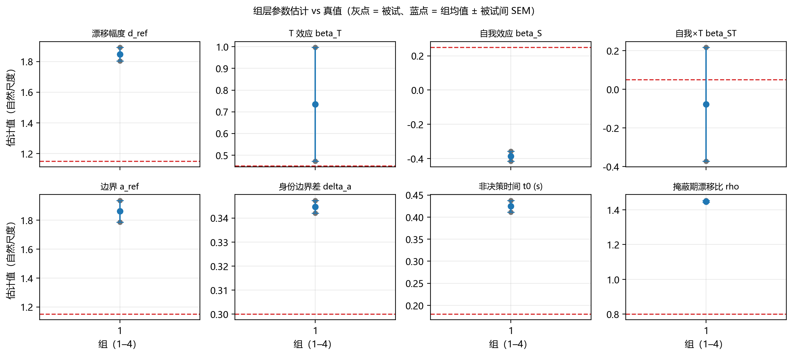
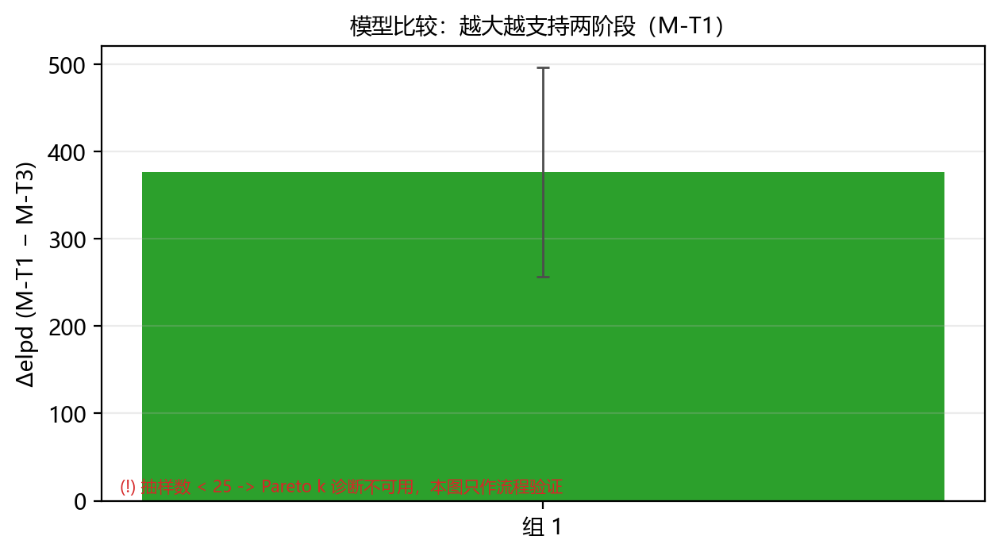

# 图目录

- 数据来源：**合成数据（仅流程验证）**
- Stage 8 目录：`1_Code\DDM_Core\_scratch\stage8_trial_s15`

## fig1_behavior_by_P.png

行为层：正确率与 RT 中位随 P 的变化（原始文件直算，不经过任何拟合）

- 文件：`1_Code\DDM_Core\_scratch\_figtest\fig1_behavior_by_P.png`

## fig2_param_recovery.png

组层参数估计（自然尺度）与真值对照；区间为 mu ± 1.96·se 的反变换近似

- 文件：`1_Code\DDM_Core\_scratch\_figtest\fig2_param_recovery.png`

## fig3_model_comparison.png

模型比较：Δelpd = elpd(M-T1) − elpd(M-T3)；正值支持两阶段

- 文件：`1_Code\DDM_Core\_scratch\_figtest\fig3_model_comparison.png`

## 模型比较数值

| 组 | Δelpd | SE | Pareto k 诊断可用 |
|---|---|---|---|
| 1 | 376.5 | 119.7 | 否（抽样数 < 25） |

> 合成数据的图**不得**进入论文结果节；它们只证明「流水线能跑通」。
