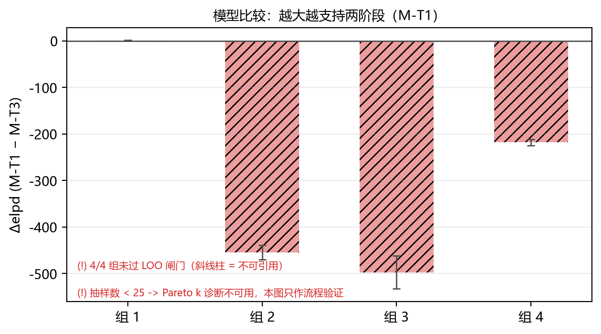
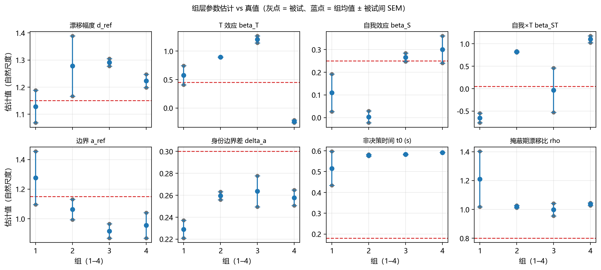

# 第 9 章 研究五：正式采集实验（P × T × W 全交叉）

> **章号待定**：建议作为「第 9 章」插入 `_v3_正文.md`，原第 9 章（总讨论）后移为第 10 章、结论后移为第 11 章。
> **本文是模板**：花括号占位处由 `1_Code/Experiment/manuscript.py` 自动填表；`【待写】` 处必须人工补论述。
> **硬纪律**：数据目录若含 `synth_truth.json`（如 `2_Data/Real_Data/_SYNTHETIC_DEMO_v1/`），
> 本章任何数字都**不得**进论文——合成数据只证明流水线可跑通（主计划 D98/D100）。

> ⚠️ **本文件由合成数据生成**（`synth_truth.json`，生成器 `1_Code/DDM_Core/_scratch/_make_ddm_pilot.py`，8 场）：只用于验证流程是否跑通，**任何数字都不得写进论文正文**（主计划 D98/D100）。

## 9.1 被试与数据质量

本研究的正式样本为【待写：实际入组人数】名健康成年被试，按练习量 P 分为四组
（P = 0 / 8 / 32 / 120 个额外练习试次，每组【待写】人）。所有人均完成 60 s 关联学习，
因此 **P = 0 不等于零暴露**（`C5`）。正式段每人 576 试次（4 个 T 水平 × 3 个 W 水平 ×
4 类刺激 × 12 次），练习段为 `max(4, P)` 个试次（组 1 为 4 个兜底试次，主计划 D93）。

场次判定采用三层口径（技术层 6-A…6-D、结构层试次计数与去重、一致层 25 列一致性），
判定为 `KEEP` 的场次才计入 N；`REVIEW` 与 `EXCLUDE` 的场次及理由如下。

表 结果-1 逐场次入库判定（来源：`_pipeline/intake_report.md`）

| 组 | 编号 | 判定 | 正式试次 | 练习试次 | 正确率 | timeout |
|---|---|---|---|---|---|---|
| 1 | 1 | KEEP | 576 | 4 | 0.587 | 10.4% |
| 1 | 2 | KEEP | 576 | 4 | 0.554 | 0.3% |
| 2 | 1 | KEEP | 576 | 8 | 0.633 | 0.7% |
| 2 | 2 | KEEP | 576 | 8 | 0.683 | 0.9% |
| 3 | 1 | KEEP | 576 | 32 | 0.786 | 0.2% |
| 3 | 2 | KEEP | 576 | 32 | 0.766 | 0.0% |
| 4 | 1 | KEEP | 576 | 120 | 0.814 | 0.0% |
| 4 | 2 | KEEP | 576 | 120 | 0.834 | 0.3% |

【待写】纳入 N、剔除理由、各组人数是否平衡、性别与年龄构成。

## 9.2 预注册判据的达成情况

Pilot 与正式采集使用同一套预注册判据（S6-1 timeout 比例、S6-2 `RT < T` 比例、
S6-3 三列矛盾行、S6-4 每格 48 试次、S6-5 正确率与过快按键、S6-6 注视期抢按）。
下表按判据 × 状态计数；任何 `FAIL` 的处置必须按 `Stage6_Pilot方案.md` §8 的触发—决定表执行。

表 结果-2 预注册判据的 PASS / WARN / FAIL / INFO 计数（来源：`_pipeline/stage6_report.md`）

| 判据 | PASS | WARN | FAIL | INFO | 未取到 |
|---|---|---|---|---|---|
| **S1-1** | 8 | 0 | 0 | 0 | 0 |
| **S1-1b** | 0 | 0 | 0 | 8 | 0 |
| **S6-3** | 8 | 0 | 0 | 0 | 0 |
| **S6-4** | 8 | 0 | 0 | 0 | 0 |
| **S6-1** | 8 | 0 | 0 | 0 | 0 |
| **S6-2** | 8 | 0 | 0 | 0 | 0 |
| **S6-2c** | 8 | 0 | 0 | 0 | 0 |
| **S6-5** | 4 | 4 | 0 | 0 | 0 |
| **S6-6** | 8 | 0 | 0 | 0 | 0 |
| **S6-2b** | 0 | 0 | 0 | 8 | 0 |

【待写】把计数转成叙述：哪条判据通过、哪条 WARN 及复核结论、有没有 FAIL 以及如何处置。

## 9.3 行为层：正确率与 RT 随练习量 P 的变化

这一节只报事实，不做模型解释（行为层效应量不蕴含参数可估，见主计划 D97 与 README §8.68）。

【待写】四组的正确率与 RT 中位、组间差异的方向与量级、是否与「练习量提升任务熟练度」的
预期一致；点 = 个体、横线 = 组均值。

## 9.4 模型比较：两阶段（M-T1）vs 单阶段（M-T3）

模型比较用 PSIS-LOO（试次层口径）。Δelpd = elpd(M-T1) − elpd(M-T3)，正值支持两阶段；
其标准误必须是**配对**口径（逐观测贡献之差的 SD × √n），否则会把同一批数据的共同变异算两遍
（实测放大 35 倍，主计划 D98）。

> **必须先读判定列**：`⛔ 不可引用` 的组，其 Δelpd 只能写进流程验证记录，不得写成模型比较证据。
> 判定依据是 `stage8_health.py` 的 D73/D74/D75 三条闸门，不是 `k_max` 一个数。

> ⛔ **本段数值不可引用**：4/4 组未过 LOO 健康闸门（D73 口径 / D74 超参数 Hessian 正定 / `p_loo` ∈ [0, `n_obs`] / `n_draws` ≥ 25）。Δelpd 只能当流程验证，不得写成模型比较证据。

> ⚠️ **组层样本量不足**：最少 2 人/组 < 10（D100）。实测：n=1 人/组时即使把 `n_em` 提到 6、`n_draws` 提到 25，仍是 `n_flipped` 2/16、`p_loo`÷`n_obs` 5.12、`k_max` 1.213、`max_abs_theta` 100.8；n=2 人/组（quick，四组）4/4 组红。⇒ 红的是**组层样本量**，不是抽样配置：加 `n_em`／`n_draws` 救不回来，只有加人或加试次。

| 组 | elpd(M-T1) | elpd(M-T3) | Δelpd（正 = 支持两阶段） | SE（配对） | `p_loo`÷`n_obs` | `n_flipped` | k 诊断 | 判定 | 原因 |
|---|---|---|---|---|---|---|---|---|---|
| 1 | -536.7 | -537.4 | +0.7 | 1.1 | 0.009 | 1/16 | 否（抽样 < 25） | ⛔ 不可引用 | 超参数 Hessian 非正定（`n_flipped` = 1/16，D74） |
| 2 | -3359.6 | -2904.8 | -454.7 | 15.6 | 2.156 | 2/16 | 否（抽样 < 25） | ⛔ 不可引用 | 超参数 Hessian 非正定（`n_flipped` = 2/16，D74）；`p_loo` = 2.42e+03 落在健康区间 [0, 1121] 之外 |
| 3 | -3899.6 | -3402.0 | -497.6 | 35.6 | 3.221 | 3/16 | 否（抽样 < 25） | ⛔ 不可引用 | 超参数 Hessian 非正定（`n_flipped` = 3/16，D74）；`p_loo` = 3.64e+03 落在健康区间 [0, 1131] 之外 |
| 4 | -2886.1 | -2668.1 | -218.0 | 6.5 | 2.330 | 3/16 | 否（抽样 < 25） | ⛔ 不可引用 | 超参数 Hessian 非正定（`n_flipped` = 3/16，D74）；`p_loo` = 2.6e+03 落在健康区间 [0, 1116] 之外 |

【待写】Δelpd 的符号与量级、SE 是否支持「明确支持 M-T1」、哪些组的数字不可引用。

## 9.5 组层参数估计

组层点估计 = 超参数均值反变换到自然尺度：`v = lo + (hi − lo)·expit(mu)`
（`lo/hi` 见 `mapping.PARAM_BOUNDS` 与 `twophase.MASK_RHO_BOUNDS`）。

表 结果-3 组层参数（M-T1，自然尺度；来源：`_pipeline/results_skeleton.md` §3）

| 组 | d_ref | beta_T | beta_S | beta_ST | a_ref | delta_a | t0 | rho |
|---|---|---|---|---|---|---|---|---|
| 1 | 1.274 | 0.589 | 0.094 | -0.533 | 1.384 | 0.210 | 0.559 | 1.280 |
| 2 | 1.426 | 0.920 | -0.000 | 0.673 | 1.189 | 0.235 | 0.560 | 1.070 |
| 3 | 1.446 | 1.166 | 0.237 | -0.044 | 1.037 | 0.235 | 0.573 | 1.044 |
| 4 | 1.386 | -0.091 | 0.269 | 0.861 | 1.077 | 0.234 | 0.582 | 1.075 |

真值（合成数据）：`d_ref`=1.15、`beta_T`=0.45、`beta_S`=0.25、`beta_ST`=0.05、`a_ref`=1.15、`delta_a`=0.3、`t0`=0.18

【待写】参数与理论预期的对照；`rho < 1` 表示掩蔽期漂移下降、`rho = 1` 退化为单阶段；
表里的区间若报 95%，必须写明是**被试间 SEM** 还是**后验**（本骨架给的是被试间 SEM）。

## 9.6 假设检验的落点：P 效应在两层的分工

- **行为层**：G\*Power 敏感性分析给出 4 组 × 40 人下可检出的最小效应 `f_min = 0.264`
  （η² = 6.5%）；192 人 ⇒ 0.241。这一层只回答「行为上有没有差异」，**不驱动 N 的一半以上**。
- **参数层**：`beta_P`（P 对漂移率的效应）的组层估计与精度来自 CRLB + 模拟恢复
  （~40 人/组，`tau_P` 先验固定 @30）；`beta_ST` 已按签批降为探索性，不进确证集。
- **两者不一致时怎么写**：以行为层写「观察到差异/未观察到差异」，以参数层写「该差异能否归因于
  漂移率」；不得用行为层的显著替代参数层的可估性结论。

【待写】本批数据在两层分别得到什么；与 `Stage6_Pilot方案.md` §5.3 的 87 份历史锚点对比。

## 9.7 本章限制

1. 【待写】样本量与功效的实际落点（recruitment 是否达到 40 人/组）。
2. 掩蔽固定 200 ms 噪声纹理、刺激呈现 33–250 ms；「无掩蔽」对照未纳入设计（主计划 D91），
   因此本章**不能**作「掩蔽是否必要」的泛化声明。
3. 模型比较的 LOO 数字需过人/组门槛（D100：2 人/组时闸门必红）；
   若本章数据低于 10 人/组，则 9.4 只作流程验证。
4. 【待写】其他实测限制（设备、被试流失、场次异常）。
